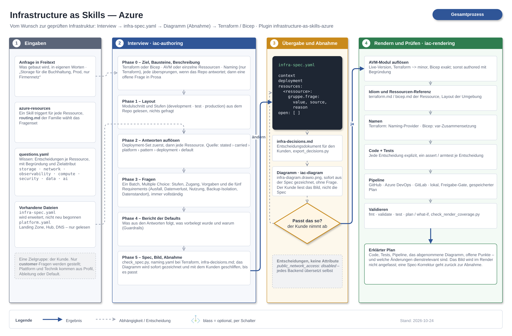
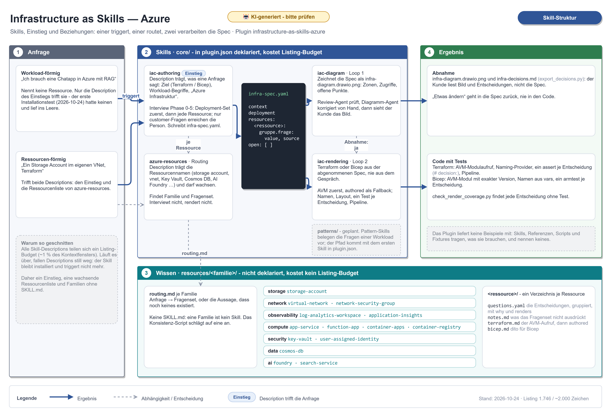

# Infrastructure as Skills: Azure

> [!NOTE]
> **AI disclaimer:** Yes, an AI helped write this, and yes, an AI is the one doing the interviewing. No, it does not get to `terraform apply`. Every decision it makes is written down with where it came from, and every render ships with a test per decision. 🤖

[](LICENSE)

A Claude Code plugin that authors Azure infrastructure as **Terraform or Bicep** from the decisions a resource actually forces. Not a module library and not a template collection. The interview writes an `infra-spec.yaml`; the code, its tests, a diagram and a decision document are rendered from that, onto [Azure Verified Modules](https://azure.github.io/Azure-Verified-Modules/) first.

## 💡 The Idea

Writing a storage account is not hard because the HCL is hard. It is hard because a storage account carries about forty decisions — public network access, TLS floor, shared key access, replication, soft delete, immutability, which subnet, which private DNS zone, where diagnostics go — and most of them are invisible until something breaks. Generic code generation gets the syntax right and the decisions wrong.

So the knowledge in this repo is shaped as a **question set**, not as a template: one per resource type, in YAML, each decision with the reasoning behind its default and the attribute it renders to. Most questions have an opinionated secure default and are never asked — they are *reported*. Only the decisions that genuinely cannot be defaulted get asked. That distinction is what keeps the interview short enough to be used.

## 🚀 Quick Start

On Claude Code 2.1.275 or later, one step:

```
/plugin install infrastructure-as-skills-azure --marketplace LemurDaniel/Infrastructure-as-Skills-Azure
```

Before that, the marketplace is added first:

```
/plugin marketplace add LemurDaniel/Infrastructure-as-Skills-Azure
/plugin install infrastructure-as-skills-azure
```

Then say what you need, in your own words and language:

```
Ich brauch ein Storage Account für die Buchhaltung, Prod, nur Firmennetz. Terraform.
```

The plugin interviews you about the system, not about the HCL: which stages, who may reach it, what an outage would cost, how much data loss is tolerable. Everything technical is derived from that, defaulted from the guardrails and *reported*, never asked. What comes out:

| File | What it is |
|---|---|
| `infra-spec.yaml` | Every decision, its value, and where it came from (`asked`, `requirement`, `platform`, `default`, `forced`) |
| `infra-decisions.md` | The same decisions as the customer reads them, in their language |
| `infra-diagram.drawio.png` | An editable draw.io picture of what gets built, for sign-off before any code |
| `*.tf` / `*.bicep` + `tests/` | The render: AVM calls with every decision explicit, one test assert per decision |
| `.github/workflows/` or `deploy.ps1` | The delivery: a pipeline per stage (GitHub, Azure DevOps, GitLab) or a local script |

Complete runs, request to tests, live under [`examples/`](examples/README.md).

## Why This Plugin?

- **Decisions, not syntax.** Every decision is explicit in the render and recorded with where it came from, so a review happens at the level decisions are actually made.
- **Secure by default, from written rules.** Defaults come from the [guardrails](plugins/infrastructure-as-skills-azure/core/iac-authoring/references/guardrails.md), not from the Azure portal and not from a module's default. The two diverge routinely, in the same direction.
- **The customer sits alone in front of it.** Only questions marked `resolved_by: interview` reach the person; platform facts come from a `platform.yaml`; a question nobody can answer becomes an `open:` item instead of a guess.
- **AVM first.** A resource with an Azure Verified Module renders as a call to it, every decision an explicit input, the version looked up live and pinned. Authored resources are the fallback, and the spec says which one it took.
- **One question set, two targets.** The questions are IaC-neutral; only `terraform.md` and `bicep.md` differ. Duplicating the decision knowledge per target is how two halves drift apart.
- **The spec is the interface.** A review happens at the level decisions are made, a regeneration is a diff, and the same spec can go to a different backend.
- **Tested per decision.** `check_render_coverage.py` fails on any spec decision that no test asserts and no `not-testable` reason excuses, for both targets.

## 🧭 How a Run Works



1. **`iac-authoring` triggers** on any request for Azure infrastructure — one that names the workload ("eine Chatapp mit RAG") as much as one that names a resource. **`azure-resources`** routes each resource through the family's `routing.md` to its question set.
2. **The interview.** The deployment-wide set first (posture, network ownership, mandates, the six requirements), then each resource. Answers resolve in order: stated › carried spec › platform › pattern › deployment › default.
3. **Sign-off.** The spec, the decision document and the diagram go to the customer. A correction is a spec change, and the loop runs again.
4. **`iac-rendering` renders** the approved spec: AVM module and version, naming, layout, code, tests, pipeline. Then `fmt`, `validate`, `test`, and the coverage check.

## 📦 What's in the Plugin

| | Purpose |
|---|---|
| [`core/iac-authoring`](plugins/infrastructure-as-skills-azure/core/iac-authoring/SKILL.md) | The entry point for any Azure infrastructure request. The interview protocol, the spec schema, the question-set format, the guardrails, the deployment-wide set, `check_spec.py` and `export_decisions.py`. |
| [`core/azure-resources`](plugins/infrastructure-as-skills-azure/core/azure-resources/SKILL.md) | Routes every resource to its family and question set. Its description is the keyword surface for resource names. |
| [`core/iac-rendering`](plugins/infrastructure-as-skills-azure/core/iac-rendering/SKILL.md) | Spec to Terraform or Bicep: the AVM contract, naming, idiom per target, pipelines, `check_render_coverage.py` and `check_pipeline.py`. |
| [`core/iac-diagram`](plugins/infrastructure-as-skills-azure/core/iac-diagram/SKILL.md) | Spec to an editable draw.io diagram with embedded source. |
| `resources/<family>/` | The knowledge. Not skills: one `routing.md` per family, one directory per resource. |
| `patterns/` | Compositions of resources with the wiring between them. **Planned, not yet present.** |

### Resource families

| Family | Resources |
|---|---|
| `storage` | storage-account |
| `network` | virtual-network, network-security-group |
| `compute` | app-service, function-app, container-apps, container-registry |
| `data` | cosmos-db |
| `security` | key-vault, user-assigned-identity |
| `observability` | log-analytics-workspace, application-insights |
| `ai` | foundry, search-service |

Each resource directory holds four files:

| File | Role |
|---|---|
| `questions.yaml` | The decisions, grouped by concern. **This is the content.** |
| `notes.md` | What the question set cannot express |
| `terraform.md` | The AVM call with the decision → input mapping, the authored rendering below it |
| `bicep.md` | The same for Bicep |

### A question set, in short

```yaml
resource: Microsoft.Storage/storageAccounts
naming:
  terraform: "Azure::Microsoft.Storage/storageAccounts"   # the naming provider's identifier
  bicep: "Microsoft.Storage/storageAccounts"
  abbreviation: "st"

groups:
  - id: networking
    questions:
      - id: public_network_access
        ask: Should this account depart from the deployment's exposure posture?
        type: enum
        values: [enabled, disabled]
        from_deployment: network_exposure
        why: >
          One posture per system. A resource that re-asks it carries the
          deployment's answer instead of a default of its own.
        renders: azurerm_storage_account.public_network_access / properties.publicNetworkAccess
```

| Group | Decides |
|---|---|
| Placement | subscription, resource group, region, stages |
| Networking | public access, firewall, private endpoints, DNS |
| Identity | managed identity, RBAC vs. keys, who gets which role |
| Security | encryption, TLS floor, key management, local auth |
| Data protection | retention, soft delete, versioning, immutability |
| Observability | diagnostic settings, which log categories, destination |

A decision that holds for more than one resource lives in the deployment-wide set and is inherited via `from_deployment`. The format is specified in [`question-set-format.md`](plugins/infrastructure-as-skills-azure/core/iac-authoring/references/question-set-format.md).

## 📐 The Spec

The interview does not produce code. It produces `infra-spec.yaml`, and a backend renders *from* it:

```yaml
deployment:
  network_exposure:
    value: private
    source: asked             # the customer's words are kept beside it
  outage_impact:
    value: business_critical
    source: asked

resources:
  storage-account:
    networking:
      public_network_access:
        value: disabled
        source: deployment    # inherited from network_exposure
    data_protection:
      blob_soft_delete_days:
        value: 30
        source: default       # guardrail, reported, never asked
open:
  - key: resources.app-service.identity.entra_client_id
    question: Which app registration does the web app sign users in with?
    owner: Workload-Team
    blocks: apply             # a placeholder in the stage file until answered
```

The spec names **decisions, never a backend's attribute spelling**: `public_network_access: disabled`, not `public_network_access_enabled: false`. The mapping to an attribute lives in the question's `renders` field and in each target's rendering reference. Module coordinates and versions stay in the renderer, never in the spec.

```
infra-spec.yaml ──> module "storage" { source = "Azure/avm-res-storage-storageaccount/azurerm" ... }
                ──> module storageAccount 'br/public:avm/res/storage/storage-account:0.33.1' = { ... }
```

Names come from this author's own naming stack: Terraform uses the [`LemurDaniel/naming`](https://registry.terraform.io/providers/LemurDaniel/naming/latest) provider; Bicep assembles the name from `var`s, since the [`utility/naming` modules](https://github.com/LemurDaniel/BICEP__Registry/tree/master/modules/utility/naming) are not ready to ship.

## Layout

```
Infrastructure-as-Skills-Azure/
├── .claude-plugin/marketplace.json
├── plugins/infrastructure-as-skills-azure/
│   ├── .claude-plugin/plugin.json
│   ├── core/                       # the skills, declared as "skills": ["./core/"]
│   │   ├── azure-resources/        # resource names -> family -> question set
│   │   ├── iac-authoring/          # the entry point; interview protocol, the spec, question-set format
│   │   │   ├── questions/deployment.yaml     # posture, network, mandates — asked once
│   │   │   ├── references/guardrails.md      # where the defaults come from
│   │   │   └── scripts/check_spec.py         # validates an infra-spec.yaml
│   │   ├── iac-rendering/          # spec -> Terraform or Bicep: AVM, naming, idiom, pipelines
│   │   └── iac-diagram/            # spec -> infra-diagram.drawio.png
│   ├── resources/                  # NOT skills: undeclared, read by azure-resources
│   │   └── storage/
│   │       ├── routing.md          # request -> question set
│   │       └── storage-account/
│   │           ├── questions.yaml
│   │           ├── notes.md
│   │           ├── terraform.md
│   │           └── bicep.md
│   └── evals/                      # claude plugin eval cases, graders, baseline
├── examples/                       # complete runs; not shipped with the plugin
├── ideas/                          # what could come next, one file each; there is no roadmap
└── PROGRESS.md                     # the state between sessions
```

### Why one trigger, and families that are not skills



Claude Code keeps a listing of every skill's name and description in context, and that listing has a **shared character budget**, [1% of the context window](https://code.claude.com/docs/en/skills) by default, each entry capped at 1,536 characters. When it overflows, descriptions are dropped silently: the skill stays listed and stops matching, because the description *is* the triggering mechanism. One report with 160 skills installed kept 20 descriptions.

Fifty Azure resources at one skill each would spend the whole budget at once. One skill per family did not survive measurement either: five skills cost 1,506 of ~2,000 characters. So the resource names live in one description: **`azure-resources` carries the resource terms and routes, the family routes further, the question set holds the knowledge**. The entry point is `iac-authoring`: its description carries what a request actually says — the target, the workload ("eine Chatapp mit RAG"), a few resource names — because a request names what the system does more often than the resources it needs. The first install test on 2026-10-24 asked for exactly that and matched nothing while `azure-resources` was the only trigger. The resource list is its own skill so that it can grow with every family without crowding out the entry description.

### Why the groups are declared, not discovered

`skills/` is scanned exactly one level deep and does not recurse, so the skills live in a scan directory declared in `plugin.json`:

```json
"skills": ["./core/"]
```

It sits beside `skills/`, not inside it, because the default scan cannot be switched off. `resources/` is deliberately **not** declared: nothing in it is a skill, so nothing in it costs budget. A declared path that does not exist fails to load the plugin, which is why `./patterns/` is not listed yet.

## 📚 Examples

[`examples/`](examples/README.md) holds complete runs, request to tests, as the reference for what a good output looks like:

| Example | What it shows |
|---|---|
| [`chat-sandbox/`](examples/chat-sandbox/) | The first full run with a customer in the conversation: a public, single-stage chat environment on authored Terraform with a local deploy script. 118 decisions. |
| [`chatbot/`](examples/chatbot/) | The complex case: twelve kinds of resource in a spoke network, split into family modules, 16 AVM calls. 284 decisions across 20 resources. |
| [`chatbot-rag/`](examples/chatbot-rag/) | A small RAG chat app on the default three-stage stack, private, authored resources, GitHub pipeline. |

An example is rendered and tested plan-only against mocked providers. **Nothing has been applied.**

## ✅ Checks

There is no build. The artefacts are Markdown and YAML; these scripts and the examples' Terraform tests are the whole verification story. Python 3.9+ with PyYAML.

```powershell
# repository consistency, incl. `claude plugin validate` on plugin and marketplace
python3 .claude/skills/git-commit-conventions/scripts/check_repo_consistency.py

# every question set against the format
python3 plugins/infrastructure-as-skills-azure/core/iac-authoring/scripts/check_question_set.py

# a spec against the contract; --require-applyable also fails on assumed values and open items
python3 plugins/infrastructure-as-skills-azure/core/iac-authoring/scripts/check_spec.py <spec>

# a rendered example: fmt, validate, plan-only tests, then every decision asserted or excused
terraform -chdir=examples/chatbot init -backend=false && terraform -chdir=examples/chatbot test
python3 plugins/infrastructure-as-skills-azure/core/iac-rendering/scripts/check_render_coverage.py examples/chatbot/infra-spec.yaml

# diagram, PNG round-trip and pipeline invariants
python3 plugins/infrastructure-as-skills-azure/core/iac-diagram/tests/run_diagram_tests.py
python3 plugins/infrastructure-as-skills-azure/core/iac-diagram/tests/run_png_tests.py
python3 plugins/infrastructure-as-skills-azure/core/iac-rendering/tests/run_pipeline_tests.py

# the end-to-end evals: a request in, the spec graded
claude plugin eval plugins/infrastructure-as-skills-azure --allow-tools Write Edit
```

## 🧪 Status

Early, and the shape matters more than the coverage. The eval baseline holds; three specs are rendered to Terraform with plan-only tests, and one Bicep render, [`eval-agent/`](eval-agent/), has been deployed to a subscription through its own rendered GitHub pipeline.

- [x] Shared contract: spec format, question-set format, interview protocol, guardrails
- [x] Deployment-wide question set, inherited by every resource via `from_deployment`
- [x] The customer interview: requirements derived into decisions, `platform.yaml`, decision document in the customer's language
- [x] Azure Verified Modules as the primary rendering, both targets, with the test contract
- [x] 14 resources in 7 families
- [x] Rendering: naming, layout, idiom and pipelines (GitHub, Azure DevOps, GitLab, local)
- [x] Diagram from the spec, editable draw.io embedded in the PNG
- [x] Checks: `check_spec.py`, `check_question_set.py`, `check_render_coverage.py`, `check_pipeline.py`
- [x] Eval suite with a baseline
- [ ] **Reference pattern skill.** `patterns/` is empty, so composition is specified but unproven
- [x] **An applied render.** [`eval-agent/`](eval-agent/) - rendered Bicep from an `infra-spec.yaml`, what-if, approval and deploy through the rendered GitHub pipeline (OIDC, no secret). The first run found what the pipeline reference now says: a job without a checkout, a what-if that skips modules, immutable OIDC subjects. One spec override came from a quota, not from the interview. Terraform and the other pipelines are still unapplied
- [ ] The complex example in Bicep; the sets added for it have no Bicep render yet
- [ ] Remaining resources: blob container, file share, queue, backup vault
- [ ] AVM version drift check; cross-backend diff of one spec

## 🔁 Relation to `Infrastructure-by-Skill`

A sibling repo pointing the other way: it drives a GUI through an agent and records the run, where this one emits code for a provider to apply. That one is explicitly an experiment, and part of the experiment is running it against systems that *do* have an API. Without a comparable IaC path next to it there is no way to tell whether a guided GUI run is merely slower or actually worse. Where both are possible, this repo is the production answer and the other one is the measurement.

## 🙏 Acknowledgments

- 🤖 [Anthropic](https://www.anthropic.com/) for Claude Code and the plugin system the whole thing hangs on
- ☁️ Microsoft for Azure and the [Azure Verified Modules](https://azure.github.io/Azure-Verified-Modules/) the decisions land on
- 🔤 [CAF Naming Conventions](https://learn.microsoft.com/en-us/azure/cloud-adoption-framework/ready/azure-best-practices/resource-abbreviations) behind the [`LemurDaniel/naming`](https://github.com/LemurDaniel/terraform-provider-naming) provider
- 🟣 [HashiCorp](https://www.hashicorp.com/) for Terraform and `terraform test`
- 💖 Open Source contributors and the community for inspiration
